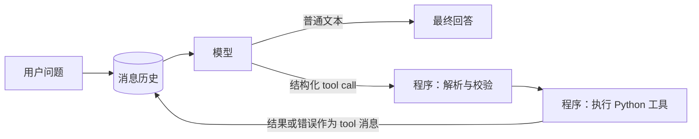
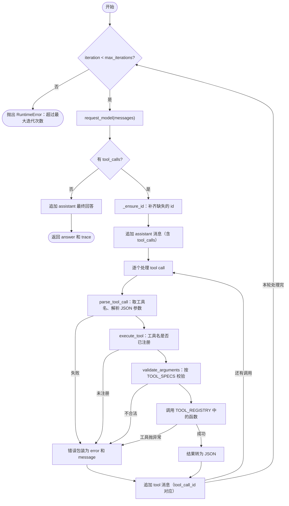
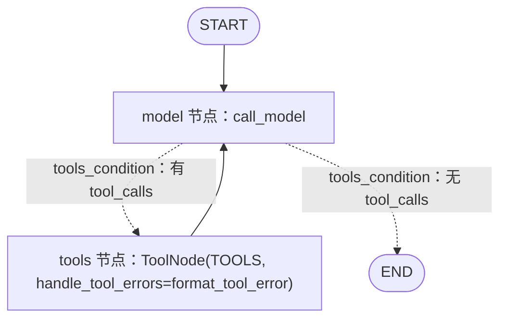
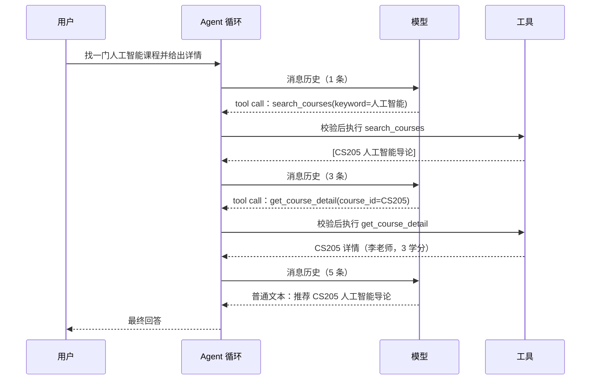

# 流程图

## 1. Tool-use 闭环（两版共同的机制）

模型只决定"调用什么、传什么参数"，真正执行函数的是程序；工具结果必须写回消息历史，模型下一轮才能看到。

## 2. Part A：`from_scratch/agent.py` 中的 `run_loop`

每个 tool call 都会产生一条 tool 消息，无论成功还是失败；只有模型适配器返回非字典这类程序错误才会直接抛出。

## 3. Part B：`langgraph_version/agent.py` 中的状态图

由 `offline_graph().get_graph().draw_mermaid()` 从实际代码导出：

- 实线是固定边（`add_edge`），虚线是条件边（`add_conditional_edges` + `tools_condition`）。
- 每个节点返回的新消息由 `add_messages` 追加到 `AgentState.messages`。
- `recursion_limit = 2 * max_iterations` 限制总步数（实测 N 次模型调用需要 2N 步）。

## 4. 一次完整运行：用例 `search_then_detail`

对应的完整消息历史见 `traces/example_run.json`。
